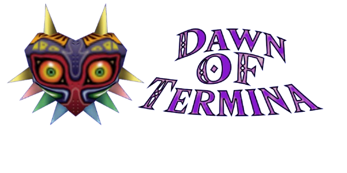

<p align="center">
  
</p>

# DawnOfTermina

Recompilação estática nativa (static recompilation / port HLE) de **The Legend of Zelda: Majora's Mask 3D** (Nintendo 3DS) para **C++20**, com renderização via **Vulkan**.

> **Este repositório não contém nenhum código, binário ou asset da Nintendo.** Você precisa de uma cópia legítima do jogo (`.cia`) que você mesmo tenha obtido. Veja o [Aviso legal](#aviso-legal).

## Visão geral

O código ARM11 original (`code.bin` do ExeFS) é traduzido automaticamente para C++ por um recompilador estático (`tools/recomp`, executado durante o build a partir da sua cópia do jogo — o código gerado nunca é distribuído), e subsistemas selecionados são analisados no Hopper Disassembler e transcritos à mão para C++ legível. Os serviços do Horizon OS (`fs`, `hid`, `gsp`, `dsp`, `cfg`, `ptm`, syscalls `svc`) são reimplementados em alto nível (HLE), e as listas de comando da GPU PICA200 são traduzidas para Vulkan. Os assets (RomFS) são lidos em tempo de execução a partir de uma extração local feita pelo usuário.

## Requisitos

| Dependência | Versão mínima | Uso |
|---|---|---|
| Compilador C++20 | GCC 12 / Clang 16 | build |
| CMake | 3.20 | build |
| Ninja ou Make | — | build |
| SDL3 | 3.2 | janela, input, áudio |
| Vulkan SDK (headers, loader) | 1.3 | renderização |
| glslang | 14+ | GLSL → SPIR-V em runtime |
| Dear ImGui | 1.91.9 | menu de configurações (baixado pelo CMake) |
| Python | 3.10 | scripts em `tools/` |

## Preparando os dados do jogo

1. Coloque sua cópia do jogo em qualquer pasta fora do controle de versão (ex.: `ISO/` ou `input/`, ambas ignoradas pelo Git).
2. Extraia ExeFS, `exheader.bin`, `code.bin` (descomprimido), `code.elf` (para o Hopper) e RomFS para `game_data/`:
   ```sh
   python3 tools/extract_cia.py "ISO/<seu jogo>.cia" game_data/ --update "ISO/<update v1.1>.cia"
   ```
   **O DawnOfTermina roda somente a versão 1.1**: o jogo base **e** a atualização oficial v1.1 (`--update`) são obrigatórios. O update é aplicado por cima do jogo base (novo `code.bin`; o RomFS do update fica em `game_data/update_romfs.bin`, ao lado do RomFS do jogo base). Antes de escrever qualquer coisa o extrator confere que o jogo é *Majora's Mask 3D*, que o `.cia` do update é a atualização deste jogo e desta região (Title ID `0004000E` + o mesmo ID do jogo) e que ela é a versão 1.1. A versão e o SHA-256 do `code.bin` ficam em `game_data/manifest.json` (gravado por último: sem ele a extração está incompleta).

   **Project Restoration (opcional):** acrescente `--restoration <arquivo>` com o pacote oficial de [restoration.zora.re](https://restoration.zora.re/) (`.zip`; `.7z` precisa de `7z` ou `bsdtar` instalados) ou uma pasta já extraída com `code.bps`, `exheader.bps`/`exheader.bin` e, opcionalmente, `romfs/`:
   ```sh
   python3 tools/extract_cia.py "ISO/<seu jogo>.cia" game_data/ --update "ISO/<update v1.1>.cia" --restoration "<Project Restoration>.zip"
   ```
   A ordem é sempre jogo base → update v1.1 → mod. Se nenhum `code.bps` do pacote tiver o CRC32 do `code.bin` extraído, o extrator para com erro antes de aplicar. Os patches BPS são aplicados por `tools/bps_patch.py` (Python puro, confere tamanhos e CRC32 de origem, patch e destino). O `manifest.json` registra `restoration_enabled`. Depois de mudar o `game_data/`, recompile (`cmake --build build`): o código do mod é recompilado junto com o jogo. Arquivos de `romfs/` do mod entram no `romfs.bin` (ver `--romfs` abaixo).

   **HUD HD / tela única (opcional, recomendado com o Project Restoration):** use o pacote *plus HD HUD* do Restoration (`mm3d_project_restoration_plus_hd_hud_v1.5.9-5-g8bb2a7b.7z`, na [página de releases](https://github.com/leoetlino/project-restoration/releases)) e o layout [*big screen*](https://restoration.zora.re/hd-hud) (`mm3d_big_screen_layout_779512b.7z`) com `--romfs`. Corações, rupias e botões de item passam para a tela de cima (é a mesma base usada pelo DekUI); no modo N64 só o minimapa continua vindo da tela de baixo:
   ```sh
   python3 tools/extract_cia.py "ISO/<seu jogo>.cia" game_data/ --update "ISO/<update v1.1>.cia" \
       --restoration mm3d_project_restoration_plus_hd_hud_v1.5.9-5-g8bb2a7b.7z --romfs mm3d_big_screen_layout_779512b.7z
   ```
   Com esse build o jogo **dispensa a tela de baixo** (porte da parte "tela única" do DekUI): título, seleção de arquivo e opções, inventário (**SELECT** abre; **L/R** trocam entre Gear, Masks, Items e Map), Bomber's Notebook, lista de músicas da Ocarina, Song of Time/Double Time, menus de dar item, minimapa (ZR+SELECT liga/desliga) e os textos que citavam a tela de toque, tudo na tela de cima e por botões. As posições são as do DekUI (`presentation.json` dele embutido); um `presentation.json` no formato do DekUI ao lado do `config.toml` as substitui. `DOT_DEKUI=0` volta aos menus originais.

   `--romfs <arquivo|pasta>` (repetível) aplica qualquer mod de RomFS: os arquivos são acrescentados ou substituídos dentro do `romfs.bin` por `tools/romfs_patch.py` (a imagem é regravada, ~650 MB).

Alternativa: abra o executável sem um `game_data/` v1.1 válido; o launcher exige os **dois** `.cia` — jogo base e update v1.1 (botão *Select...* para cada um; sugere arquivos de `ISO/`) — e só libera *Extract and start* com os dois escolhidos. Arquivos errados (outro jogo, outra região, update que não é o 1.1, criptografados) são recusados com a mensagem do extrator. Pela linha de comando: `dawnoftermina [game_data] --base <jogo.cia> --update <update_v1.1.cia>`. O executável procura `game_data/` no diretório atual e ao lado do binário (`build/../game_data`), então também abre por duplo clique.

Como o código do jogo é recompilado **no build**, o executável só roda o `code.bin` para o qual foi compilado (o SHA-256 do `manifest.json` é conferido ao abrir). Extraiu outra combinação (por exemplo, sem o Project Restoration)? Recompile apontando para ela (`-DDOT_GAME_DATA=<pasta>`).

O extrator é Python puro (sem dependências externas) e exige `.cia`s **descriptografados** (jogo e update); ele avisa e aborta se o conteúdo estiver criptografado. Updates baixados da eShop costumam vir criptografados: decifre-os antes (por exemplo, com o GodMode9 no seu próprio console).

## Compilando

O build exige um `game_data/` extraído da **v1.1** (jogo base + update; ver acima) e recompila o `code.bin` dele (≈3 min em 6 núcleos; requer ~4 GB de RAM livres). Sem ele, o CMake para com erro explicando como extrair. Outra pasta: `-DDOT_GAME_DATA=<pasta>`.

```sh
cmake -S . -B build -G Ninja -DCMAKE_BUILD_TYPE=Release
cmake --build build
(cd build && ctest --output-on-failure)
./build/dawnoftermina game_data
```

### Pasta autocontida (`dist/`)

```sh
cmake --install build --prefix dist
```

Gera `dist/dawnoftermina` com `dist/tools/extract_cia.py`, `dist/shaders/*.spv` e `dist/pipeline_seed.bin` ao lado. Aberto sem um `game_data/` v1.1, ele pede o jogo base e o update v1.1 (`.cia`) e extrai para `dist/game_data` (precisa de `python3`); configurações, saves e caches também ficam em `dist/`.

**Build recomendado (Project Restoration + HD HUD + DekUI):** compile contra uma extração com `--restoration mm3d_project_restoration_plus_hd_hud_v1.5.9-5-g8bb2a7b.7z --romfs mm3d_big_screen_layout_779512b.7z` (ou `--download-mods`, que baixa os dois das páginas oficiais e confere o SHA-256). O launcher desse build faz o mesmo sozinho: depois dos dois `.cia`, **baixa e aplica os dois pacotes** (~0,7 MB), então o jogo abre já com o Restoration, o HUD HD e a interface de tela única do DekUI, mesmo na primeira vez.

**Shaders e pipelines compilados antes de o jogo abrir:** logo depois da extração, ainda na janela do launcher (barra de progresso), todos os pipelines de `pipeline_seed.bin` são gerados a partir dos `.shbin` do **seu** RomFS, compilados para SPIR-V e criados no Vulkan em várias threads; os caches (`cache/spirv_cache.bin`, `cache/pipeline_cache.bin`, `cache/pipeline_manifest.bin`) ficam prontos. Ao abrir, o jogo cria todos os pipelines conhecidos antes de iniciar a thread do guest; o terminal registra qualquer shader/pipeline que ainda compile durante o jogo (`... compiled on demand`), e ele entra no manifesto para a próxima vez. A semente guarda só parâmetros (registradores do TEV/blend/depth, hash do bloco de código do `.shbin`, entrada, uniforms bool/int): nenhum shader ou asset do jogo. O executável contém o código do jogo recompilado da **sua** cópia: é para uso pessoal, não distribua.

### Configuração e controles

Na primeira execução é criado um `config.toml` ao lado de `game_data/` (ignorado pelo Git) com: **1080p**, widescreen **16:9**, **tela única estilo N64** (corações, itens I/X/Y/II, Ocarina e minimapa recortados da tela de baixo para os cantos; ao abrir um menu da tela de toque — Items, Masks — a tela de baixo aparece ampliada no centro, sobre o jogo escurecido, e some ao fechar), VSync e **30 FPS**. O modo **60 FPS** (quadros intermediários interpolados; a lógica do jogo continua a 30 Hz) renderiza o dobro na GPU: ative no menu se ela tiver folga na resolução escolhida (uma Intel Iris Xe mantém 720p a 60 FPS). Tudo pode ser mudado em jogo no menu (**F1** ou **Esc**) e é salvo na hora, inclusive a resolução interna: 1080p = 4×, 720p = 3×, 240p = 1× (a escala é inteira).

| Tecla | Ação |
|---|---|
| K / J / I / U | A / B / X / Y |
| Q / E, 1 / 3 | L / R, ZL / ZR |
| WASD, setas | circle pad, D-pad |
| Enter / Backspace | Start / Select |
| F / G / O / M | botões de toque: item I / item II / Ocarina / mapa |
| F2 | câmera no mouse (captura o cursor; Esc solta) |
| C / V / Z | menus Items / Masks / Gear (toque) |
| Tab | minimapa (N64) ou tela de baixo (tela única) |
| F3 | tela de baixo inteira no centro (N64: Ocarina, banco, códigos) |
| F11 | tela cheia |
| F5 / F9 | salvar / carregar savestate |
| F1 / Esc | menu de configurações |

**FOV da câmera** (aba *Video* e `[camera]` do `config.toml`): 45° é o original; até 70° alarga a visão do jogo e, separadamente, das cutscenes. Disponível no build com Project Restoration (na v1.1 sem o mod os endereços ainda não foram mapeados).

Teclas remapeáveis no menu (aba *Controls*). Controle: layout posicional da Nintendo (leste = A), analógico direito = câmera (C-stick), L3/R3 = itens I/II. Mouse: clique na tela de baixo = toque; no modo N64, clicar num ícone do canto toca o botão correspondente. O overlay de desempenho (off / só FPS / completo com 1% low, CPU, GPU e RAM) e sua opacidade ficam no F1 (aba *Video*) e em `[performance]`. Escala/opacidade do HUD e o minimapa ficam no F1 (aba *Video*) e em `[hud]` do `config.toml`; o modo pode ser `n64`, `single` ou `dual`.

**C-stick:** o jogo conversa com um *Circle Pad Pro* emulado. Na tela "This game supports the Circle Pad Pro" aperte **ZR** (tecla 3 ou gatilho direito) para ativá-lo; *Don't Use* deixa a câmera só no botão L.

Variáveis de ambiente `DOT_*` têm prioridade sobre o `config.toml` (úteis para testes): `DOT_RES_SCALE=1..8|native`, `DOT_WIDESCREEN=16:9|21:9|window`, `DOT_WINDOW=1920x1080`, `DOT_FPS=30|60`.

## Arquitetura

```
src/
  core/         memória virtual do 3DS (FCRAM, VRAM, DSP RAM, TLS), tipos base, utilitários
  hle/          serviços do Horizon OS (srv, fs, hid, gsp, dsp, cfg, ptm) e syscalls svc
  gfx/vulkan/   tradutor PICA200 -> Vulkan (registradores, shaders, TEV, formatos de textura)
  game/         código do jogo transcrito do ARM11, organizado por subsistema e endereço original
tests/          self-test do runtime (ctest)
src/recomp/     runtime do código recompilado (contexto da CPU, flags, VFP, despacho, syscalls)
tools/recomp/   recompilador estático ARM/Thumb/VFP -> C++
tools/          extração do .cia, símbolos
```

Cada função transcrita mantém o endereço virtual original em comentário (`// Original VA: 0x00104A20`) para rastreabilidade 1:1.

## Status

| Etapa | Descrição | Status |
|---|---|---|
| 1 | Bootstrap do repositório, licença, documentação | ✅ |
| 2 | Pipeline de extração do `.cia` — **somente v1.1**: jogo base + update v1.1 obrigatórios (`--update`, também exigidos pelo launcher); Project Restoration via `--restoration`, mods de RomFS como o HD HUD via `--romfs` — e preparação do binário para o Hopper | ✅ |
| 3 | Runtime, memória e HLE do Horizon OS | ✅ |
| 4 | Backend Vulkan e tradutor PICA200 | 🟡 draws em lote, vertex shaders na GPU e iluminação por fragmento; cenas com personagens renderizadas; cache de shaders/pipelines em disco (sem engasgos), fog e stencil; faltam sombras |
| 5 | Entry point (`_start` / `nnMain`) | ✅ (o boot roda recompilado; o crt0 transcrito da v1.0 foi removido) |
| 6 | Recompilador estático automático ARM11 → C++ | ✅ boot do SDK roda recompilado até a criação de threads |
| 7 | Threads do guest e serviços do sistema até o primeiro frame | ✅ título, criação de arquivo (teclado HLE), cutscene inicial da Lost Woods e Link controlável (circle pad) a ~60 VBlanks/s; com Project Restoration, South Clock Town (relógio do HUD HD) |
| 8 | Áudio: HLE do DSP (24 vozes, PCM8/PCM16/ADPCM) com saída via SDL3 | ✅ música e efeitos; sem reverb/filtros |
| 9 | Renderização em alta resolução (`DOT_RES_SCALE`) com framebuffers residentes na GPU | ✅ |
| 10 | Widescreen real (`DOT_WIDESCREEN=16:9`, `21:9`, `window`…) | ✅ |
| 11 | 60/90/120 FPS por interpolação de quadros (`DOT_FPS`), sem acelerar a lógica; câmera interpolada como movimento rígido (DekUI); ritmo de apresentação por linha do tempo | ✅ |
| 12 | Hooks nativos para rotinas da libc (memcpy/memset/strlen/strcmp/sinf/cosf/atan2f) | ✅ infraestrutura; ganho medido dentro do ruído |
| 5E | Experiência de PC: `config.toml`, menu ImGui (F1), tela única N64/tela única/dupla, câmera no mouse (C-stick), atalhos de toque | ✅ |
| 13 | Savestates: F5 salva, F9 carrega (`states/slot1.state`), `DOT_LOAD_STATE=<arquivo>` no boot | ✅ |
| 14 | Tela única: toda a interface da tela de toque na tela de cima (porte do DekUI, build HD HUD) | 🟡 |
| 15 | Shaders fixos em SPIR-V no build; semente de pipelines compilada no launcher (após a extração) e pipelines criados antes da thread do guest; Restoration + HD HUD + DekUI baixados e aplicados pelo launcher | ✅ |
| 16+ | Subsistemas do jogo (cenas, loop, colisão, atores, HUD) | ⏳ |

## Contribuindo

O desenvolvimento acontece na branch `dev` (ou em branches derivadas dela). Nada é commitado direto na `main`: as mudanças entram por Pull Request de `dev` para `main`.

## Créditos

- **[Project Restoration](https://restoration.zora.re/)** ([código](https://github.com/leoetlino/project-restoration)), de **leoetlino** e colaboradores (GPL-2.0): o mod de jogabilidade que o extrator aplica com `--restoration` a partir do pacote oficial (fornecido pelo usuário ou baixado pelo launcher/`--download-mods` da página de releases, com SHA-256 fixo). Nenhum arquivo do mod é distribuído aqui.
- **[DekUI](https://gamebanana.com/mods/723825)** ([código](https://github.com/tgacquin/mm3d-dekui)), de **Thomas (tgacquin)** e dos *MM3D presentation contributors*, sobre o Azahar e o Project Restoration: toda a interface de tela única (headers do DekUI copiados sem modificação em `src/dekui/`, cola em `src/recomp/dekui.cpp`, padrões de `resources/dekui/presentation.json` lidos por uma transcrição do `Settings::Load` dele em `src/recomp/dekui_settings.cpp`), correção do fundo da pausa (PC do `PauseCapture`), base da interpolação de câmera do modo 60 FPS (ponto médio rígido por quaternion e detecção de cortes, `src/gfx/camera_midpoint.h`) e do FOV ajustável (hook em `0x18D570`/`0x18D584`, `src/recomp/hooks.cpp`). Trechos portados do código GPL-2.0-or-later do DekUI, com atribuição nos arquivos.
- **[Citra](https://github.com/citra-emu/citra) / [Azahar](https://github.com/azahar-emu/azahar)** e **[3dbrew](https://www.3dbrew.org/)**: referência para o PICA200, o DSP e os serviços do Horizon.

## Licença

O código-fonte original deste projeto é distribuído sob a **GNU General Public License v3.0 ou posterior** — veja [`LICENSE`](LICENSE).

## Aviso legal

DawnOfTermina é um projeto independente, sem afiliação com a Nintendo. *The Legend of Zelda* e *Majora's Mask* são marcas registradas da Nintendo. Este repositório não distribui ROMs, binários, assets ou código proprietário; o projeto funciona exclusivamente no modelo *bring-your-own-ROM*, exigindo uma cópia legalmente adquirida do jogo. Não use este projeto para pirataria.
